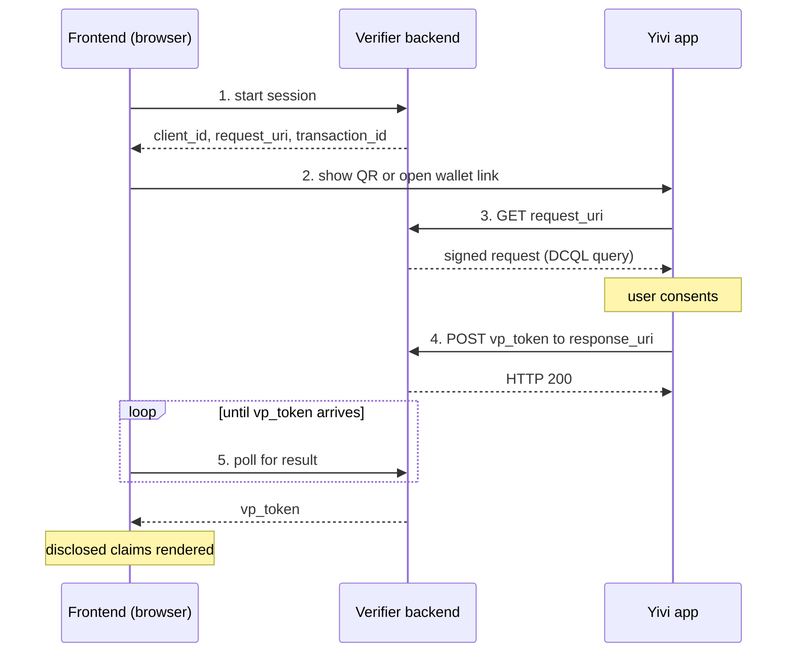
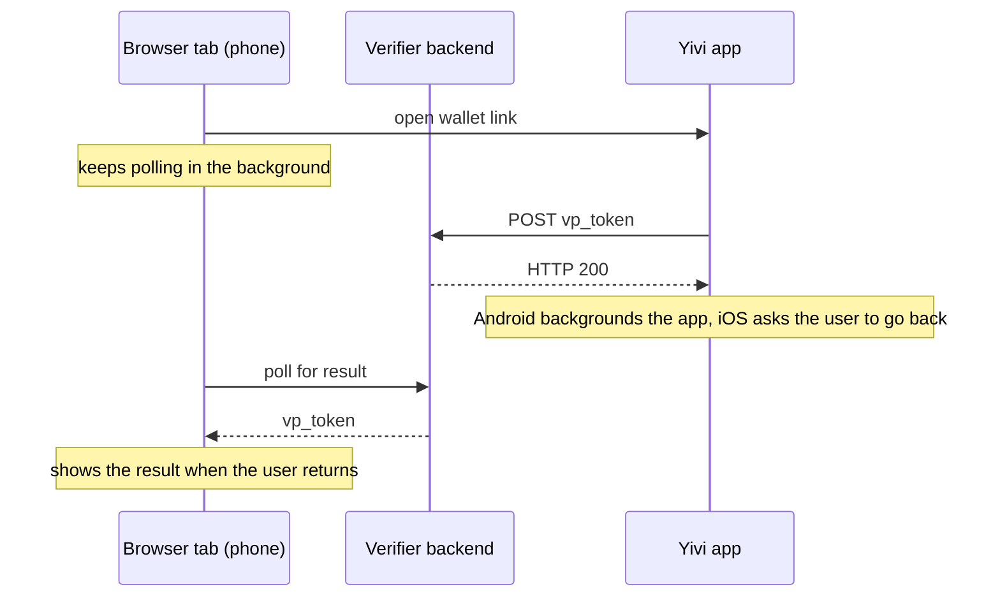

This guide takes you from nothing to a working OpenID4VP disclosure with the Yivi app. It covers what the app expects from your verifier, the code you need in your frontend, and the behaviour of the app that you have to design around.

The code samples are distilled from the [openid4vp-demo-frontend](https://github.com/privacybydesign/openid4vp-demo-frontend) reference implementation. For background, read the [OpenID4VP Introduction](openid4vp-introduction.md) first. Verifier certificates are described in detail on [Disclosing SD-JWT VCs over OpenID4VP](openid4vp-disclosure.md).

:::info Version
This page describes the behaviour of Yivi app `8.4.0`, which embeds `irmago` `1.5.0`. Older app versions support less: OpenID4VP itself arrived in `7.10.0`, the `openid4vp://` scheme in `7.11.0`, verifiers identified by a DID in `8.0.0`, and mdoc, requests passed by value and the `redirect_uri` prefix in `8.3.0`.
:::

## Before you start

You need three things:

1. **A verifier certificate.** The app identifies your verifier by an X.509 certificate that chains to the Yivi Relying Parties CA. The certificate lists the credentials and attributes you are allowed to request. See [Verifier certificates](openid4vp-disclosure.md#verifier-certificates) for how to obtain one.
2. **A verifier backend.** This is a server that holds the certificate's private key, signs authorization requests, and receives the wallet's response. Any OpenID4VP 1.0 verifier that meets the requirements [below](#what-the-yivi-app-supports) will do. Our demo uses the [EUDI reference verifier](https://github.com/eu-digital-identity-wallet/eudi-srv-verifier-endpoint).
3. **A Yivi app** with the credentials you want to request.

### Staging and production

| | Production | Staging |
|---|---|---|
| Certificate issued by | Yivi Relying Parties CA | Yivi Staging Relying Parties CA |
| App setting | None | [Developer mode](yivi-app.md#developer-mode) must be on |
| Credential identifiers | `pbdf.…` | `pbdf-staging.…`, `irma-demo.…` |
| Universal link host | `open.yivi.app` | `open.staging.yivi.app` |

The app only trusts staging certificates when developer mode is enabled. With developer mode off, a session from a staging verifier fails with a certificate error, so remember this when you hand a test build to colleagues.

## Architecture

A verifier integration involves three components:

- **Frontend**: runs in the user's browser. It asks the backend to start a session, shows the wallet link or QR code, waits for the result, and shows the outcome to the user.
- **Verifier backend**: your server. It signs the authorization request with the verifier certificate and receives the `vp_token` from the wallet.
- **Yivi app**: the wallet. It fetches the authorization request, validates the verifier certificate, asks the user for consent, and posts the `vp_token` to your backend.



## What the Yivi app supports

Yivi implements a subset of [OpenID4VP 1.0](https://openid.net/specs/openid-4-verifiable-presentations-1_0.html). Check your verifier backend against this table before you start.

| Area | Supported | Not supported |
|---|---|---|
| Query language | DCQL (`dcql_query`) | Presentation Exchange (`presentation_definition`), `scope` |
| Passing the request | By reference (`request_uri`, fetched with GET) and by value (`request`) | `request_uri_method=post`; the app does not send `wallet_metadata` or `wallet_nonce` |
| Client identifier prefix | `x509_san_dns`, `x509_hash`. For testing also `decentralized_identifier` and `redirect_uri`, see [below](#testing-without-a-certificate) | `openid_federation`, `verifier_attestation`, pre-registered clients (no prefix) |
| Response type | `vp_token` | Everything else |
| Response mode | `direct_post`, `direct_post.jwt` | `fragment`, `query`, Digital Credentials API |
| Credential format | `dc+sd-jwt`, `mso_mdoc`, `vc+sd-jwt`, see the next table | Idemix. Use the [IRMA protocol](irma-protocol.md) for that |

### Supported credential formats

The Yivi app answers DCQL credential queries in these formats:

| `format` | Credential | Selected by | Since |
| --- | --- | --- | --- |
| `dc+sd-jwt` | IETF SD-JWT VC | `meta.vct_values` | Yivi app 7.10.0 |
| `mso_mdoc` | ISO/IEC 18013-5 mdoc | `meta.doctype_value` | Yivi app 8.3.0 (irmago v1.4.0) |
| `vc+sd-jwt` | SD-JWT-secured W3C VCDM 2.0 credential | `meta.type_values` (fully expanded types) | Yivi app 8.4.0 (irmago v1.5.0) |

Each format answers only its own queries: an SD-JWT VC is never offered for a `vc+sd-jwt` query, nor a VCDM credential for a `dc+sd-jwt` one.

## Step 1: Build the DCQL query

A [DCQL query](https://openid.net/specs/openid-4-verifiable-presentations-1_0.html#name-digital-credentials-query-l) describes the credentials and claims you want. The example below asks for the email address and its domain from the Yivi email credential:

```ts
const dcqlQuery = {
  credentials: [
    {
      id: "email",
      format: "dc+sd-jwt",
      meta: { vct_values: ["pbdf.sidn-pbdf.email"] },
      claims: [
        { path: ["email"] },
        { path: ["domain"] },
      ],
    },
  ],
}
```

For credentials from a Yivi scheme, the `vct_values` entry is the credential identifier from the [attribute index](https://portal.yivi.app/attribute-index), and each claim `path` holds a single attribute name.

An mdoc is selected by its docType, and each claim path is exactly `[namespace, elementIdentifier]`. The app refuses any other path shape for `mso_mdoc`:

```ts
const dcqlQuery = {
  credentials: [
    {
      id: "age",
      format: "mso_mdoc",
      meta: { doctype_value: "eu.europa.ec.av.1" },
      claims: [{ path: ["eu.europa.ec.av.1", "age_over_18"] }],
    },
  ],
}
```

### DCQL features and limits

| Feature | Behaviour in the Yivi app |
|---|---|
| `claims[].values` | Supported. The credential only matches when the claim has one of the listed values. |
| `claim_sets` | Supported. The first set the user's credential can satisfy is used. |
| `credential_sets` | Supported, with one limit: each option may contain exactly one credential query id. An option such as `["email-id", "phone-id"]` makes the session fail. |
| `credential_sets[].required: false` | Supported. The user can leave the optional credentials out. |
| `multiple` | Supported when the query has no `credential_sets`. |
| `require_cryptographic_holder_binding: false` | Supported for SD-JWT formats. The presentation is then sent without a key binding JWT. |
| `trusted_authorities` | Ignored. The app does not filter credentials by issuer. |
| `claims` on `mso_mdoc` | Required. A query without it fails. |

If the user owns none of the optional credentials you ask for, or declines all of them, the app still responds, with an empty `vp_token` object. Make sure your backend accepts that.

More query patterns, with their condiscon equivalents, are on the [disclosure page](openid4vp-disclosure.md#dcql-queries).

### Stay within your certificate

A Yivi-issued verifier certificate lists the credentials and attributes you may request. If your query asks for anything outside that list, the app rejects the whole request before the user sees it. There is no partial disclosure. When you add an attribute to a query, check that your certificate covers it.

## Step 2: Create the authorization request

How you create the request depends on your verifier backend. Whatever backend you use, the signed request object the app fetches has to meet these requirements:

- The JWT header has `typ` set to `oauth-authz-req+jwt` and carries the certificate chain in `x5c`. The leaf certificate signs the request and must have the `digitalSignature` key usage. The chain may include intermediate CA certificates (since Yivi app 8.3.1), as long as it leads to a trusted root.
- `response_type` is `vp_token`.
- `response_mode` is `direct_post` or `direct_post.jwt`, and `response_uri` is set.
- `nonce` is present and contains only letters, digits, and the characters `-`, `.`, `_` and `~`.
- `dcql_query` is present and `scope` is absent.
- With an `x509_san_dns` client identifier, the host of `response_uri` equals the DNS name in `client_id`, and the leaf certificate has that DNS name as a subject alternative name.
- With `direct_post.jwt`, `client_metadata.jwks` contains an encryption key whose `alg` is a key encryption algorithm. Without it the session fails.
- If `exp`, `nbf` or `iat` are present they are enforced, with two minutes of leeway.

### Example with the EUDI reference verifier

:::caution Backend-specific API
The request shape below, including `issuer_chain`, `intended_use_id`, the `/ui/presentations` endpoint and the polling endpoint further down, is not defined by OpenID4VP. It belongs to the [eudi-srv-verifier-endpoint](https://github.com/eu-digital-identity-wallet/eudi-srv-verifier-endpoint) reference server and depends on the version you deploy. A different verifier backend has a different frontend-facing API.
:::

```ts
const authorizationRequest = {
  dcql_query: dcqlQuery,
  nonce: crypto.randomUUID(),
  jar_mode: "by_reference",
  intended_use_id: "1", // configured in your verifier deployment
  issuer_chain: ISSUER_CHAIN, // PEM-encoded X.509 chain of the issuers you accept
}

const response = await fetch(`${API_URL}/ui/presentations`, {
  method: "POST",
  headers: { "Content-Type": "application/json" },
  body: JSON.stringify(authorizationRequest),
})

const session = await response.json()
const transactionId = session["transaction_id"]
```

Two details depend on the verifier version. From v0.11.0, `eudi-srv-verifier-endpoint` refuses a transaction that names neither an intended use (`intended_use_id`, configured on the server) nor a registration certificate. It also enforces the `request_uri_method` a transaction was started with. The Yivi app always fetches the request object with a GET, so leave `request_uri_method` out and let the server's default apply, or set it to `get`. Never set it to `post`.

## Step 3: Hand the request to the app

Build a wallet link from the parameters your backend returned:

```ts
const { transaction_id, ...linkParams } = session
const walletLink = `openid4vp://?${new URLSearchParams(linkParams)}`
```

The link must contain `client_id` together with either `request_uri` or `request`. A link without `client_id` is ignored by the app without any message to the user. The `client_id` in the link has to be identical to the one in the signed request.

The app accepts the `openid4vp://` and `eudi-openid4vp://` schemes and treats them the same.

### QR code or link

- **On a desktop browser**, render `walletLink` as a QR code. The user scans it with the scanner in the Yivi app.
- **On a phone**, navigate to `walletLink`, for example from a button. The app opens directly.

The app decides between the two flows by how the session arrived. A session started from the scanner in the Yivi app is a cross-device session. A session that arrives as a link is a same-device session. A QR code scanned with the phone's camera app arrives as a link and is therefore handled as same-device.

### Universal links (optional)

Any app on the device can claim the `openid4vp://` and `eudi-openid4vp://` schemes. On a phone with several wallets the user gets a chooser, and a hostile app could register the same scheme. To make a session open in the Yivi app only, wrap the link in a universal link. The operating system checks the host against Yivi's `apple-app-site-association` and `assetlinks.json` files, so only Yivi can claim it.

Replace the scheme with the universal link host and path, and keep the query string exactly as it is:

```
openid4vp://?client_id=x509_san_dns:verifier.example&request_uri=https://verifier.example/req/abc
    ↓
https://open.yivi.app/-/openid4vp?client_id=x509_san_dns:verifier.example&request_uri=https://verifier.example/req/abc
```

Both schemes map to the same `/-/openid4vp` path. Use `https://open.staging.yivi.app/-/openid4vp` for staging builds. Do not add path segments after `/-/openid4vp`, the app rejects those.

## Step 4: Receive the response

After the user consents, the app sends a form-encoded POST to your `response_uri`:

- With `direct_post`, the form has a `vp_token` field and a `state` field. `state` is always present and is empty when your request had none.
- With `direct_post.jwt`, the form has a single `response` field containing a JWE. Its payload is a JSON object with `vp_token` and `state`.

The `vp_token` is a JSON object that maps each credential query `id` to an array of presentations:

```json
{
  "email": ["eyJ0eXAiOiJkYytzZC1qd3Qi...~WyJzYWx0Iiw...~eyJ0eXAiOiJrYitqd3Qi..."]
}
```

Your endpoint has to answer with **HTTP 200**. Any other status makes the app show an error to the user, even when your backend processed the response.

### Getting the result to your frontend

With the EUDI reference verifier, poll the result endpoint until the response is in:

```ts
// The reference verifier returns one presentation or an array of them per query.
function presentationsOf(entry: unknown): string[] {
  if (typeof entry === "string") return [entry]
  if (Array.isArray(entry)) return entry.filter((p): p is string => typeof p === "string")
  return []
}

const id = setInterval(async () => {
  const result = await fetch(`${API_URL}/ui/presentations/${transactionId}`)
  if (result.status !== 200) return // still waiting

  clearInterval(id)
  const body = await result.json()
  const vpToken = body["vp_token"] as Record<string, unknown>
  const disclosures = Object.entries(vpToken).map(([queryId, entry]) => ({
    queryId,
    claims: presentationsOf(entry).flatMap(parseSdJwtVc),
  }))
  renderDisclosures(disclosures)
}, 1000)
```

The snippet assumes SD-JWT VC presentations. An SD-JWT presentation always contains a `~`, so you can tell it apart from an mdoc presentation without looking at the request.

Polling keeps the example small. In production, server-sent events or WebSockets avoid the repeated requests.

### Things the app does not do

Design your flow around these three points:

- **The app does not tell you when the user cancels.** If the user declines or closes the session, nothing is sent to your backend. Expire sessions yourself and give the user a way to start again.
- **The app does not follow a `redirect_uri`.** The body of your response to the POST is not read, so the app cannot send the user to a result page. On a phone, your original browser tab has to pick up the result itself, by polling or a push channel as shown above.
- **The app does not switch back to the browser on iOS.** After a same-device session, Android puts the Yivi app in the background, which brings the browser forward again. iOS shows a screen asking the user to tap the back link in the top left corner.



## Step 5: Verify and parse the presentation

Your verifier backend should verify every presentation before your application trusts it. For an SD-JWT VC that means:

- The issuer's signature on the JWT, against the issuers you trust.
- The validity period of the credential.
- That each disclosure's hash occurs in the signed JWT.
- The key binding JWT: its signature against the key in the credential's `cnf` claim, its `nonce` against the nonce of your request, its `sd_hash`, and its `aud`.

The `aud` of the key binding JWT is your full `client_id`, including the prefix, for example `x509_san_dns:verifier.example`. The key binding JWT is signed with ES256.

The EUDI reference verifier does these checks before it exposes the result. That is why the frontend below only parses:

```ts
function base64UrlDecode(input: string): string {
  const base64 = input.replace(/-/g, "+").replace(/_/g, "/")
  const padded = base64.padEnd(Math.ceil(base64.length / 4) * 4, "=")
  const bytes = Uint8Array.from(atob(padded), (c) => c.charCodeAt(0))
  return new TextDecoder().decode(bytes)
}

function parseSdJwtVc(sdjwt: string): { key: string; value: unknown }[] {
  const parts = sdjwt.split("~")
  // The first part is the issuer-signed JWT. The last part is the key binding JWT,
  // or an empty string when there is none.
  const disclosures = parts.slice(1, -1)

  return disclosures
    .map((d) => JSON.parse(base64UrlDecode(d)) as unknown[])
    // Object properties are [salt, name, value]. Array elements are [salt, value].
    .filter((d) => d.length === 3)
    .map(([, name, value]) => ({ key: name as string, value }))
}
```

Disclosures are base64url encoded, so decode them as such. Plain `atob` fails on values containing `-` or `_`.

For `mso_mdoc`, each presentation is a base64url-encoded ISO 18013-5 `DeviceResponse`, which you decode as CBOR. See `src/mdoc.ts` in the demo frontend.

A `vc+sd-jwt` query that requires holder binding is answered with a W3C Verifiable Presentation (`typ` `vp+jwt`) that envelopes the SD-JWT as an `EnvelopedVerifiableCredential`. The presentation's signature is the holder proof, so the enveloped SD-JWT has no key binding JWT. Without holder binding the SD-JWT is sent as is.

## What the user sees

**Your name and logo.** The app shows who is asking, taken from the first of these that is available:

1. `client_name` and `logo_uri` in the `client_metadata` of your request.
2. The organization name and logo in your Yivi verifier certificate.
3. The common name of the certificate, without a logo.

**Verified or not.** A verifier with a valid certificate gets a green badge and the text that it is a known party registered with Yivi. A verifier without a certificate gets a red warning. See [Trusted Verifier](trusted-verifier.md) for screenshots.

**Choices.** Each credential query, or each credential set, becomes one item in the disclosure screen. When the user owns several matching credentials they can change the choice. Optional credential sets are offered behind an "add optional data" card.

**Missing credentials.** If the user lacks a required credential from a Yivi scheme, the app offers to obtain it and resumes your session afterwards. For other credentials the app shows what is missing and the user can only close the session.

**PIN.** There is no PIN prompt during the disclosure. If the app is locked when the session arrives, the user has to unlock it with their PIN first.

### Testing without a certificate

Two client identifier prefixes work without a Yivi verifier certificate. Both show the red "not known by Yivi" warning, so use them for development only.

- `decentralized_identifier` with `did:jwk` or `did:web`, in a signed request.
- `redirect_uri`, in an unsigned request whose parameters are passed in the link itself. The `response_uri` has to match the URL in the `client_id`. The app shows such a verifier without a logo, named by the address the response is sent to.

No authorization check on requested attributes applies to these verifiers.

## Troubleshooting

When a session fails inside the app, the user sees a general "Something went wrong" screen. The cause is behind **Show technical details**. Look for these messages:

| Message contains | Cause |
|---|---|
| Nothing happens when the link is opened | The link has no `client_id`, or the universal link path is not exactly `/-/openid4vp`. |
| `authorization request returned HTTP …` | The `request_uri` did not answer 200. The session may have expired on your backend, or the backend expects a POST. |
| `failed to verify relying party certificate` | The certificate does not chain to a trusted CA, is revoked, or is a staging certificate while developer mode is off. |
| `failed to verify queried credentials` | The query asks for a credential or attribute that your certificate does not authorize. |
| `unsupported client_id scheme` | The `client_id` prefix is not one of the supported ones. |
| `response_type must be` | `response_type` is not `vp_token`. |
| `no credential query handler` | The `format` of a credential query is not supported. |
| `not supported at the moment` | A `credential_sets` option contains more than one credential query id. |
| `are exhausted` | The user's credential has no unused instances left. The user has to obtain it again. |
| `response status was not ok` | Your `response_uri` answered the POST with a status other than 200. |

## Where to go next

- [Disclosing SD-JWT VCs over OpenID4VP](openid4vp-disclosure.md): verifier certificates and more DCQL examples.
- [Trusted Verifier](trusted-verifier.md): how to register your organization.
- [openid4vp-demo-frontend](https://github.com/privacybydesign/openid4vp-demo-frontend): the full reference implementation, with SD-JWT VC and mdoc presets for the EUDI verifier, Veramo verifiers for `vc+sd-jwt`, and IRMA-protocol verification side by side with OpenID4VP.
