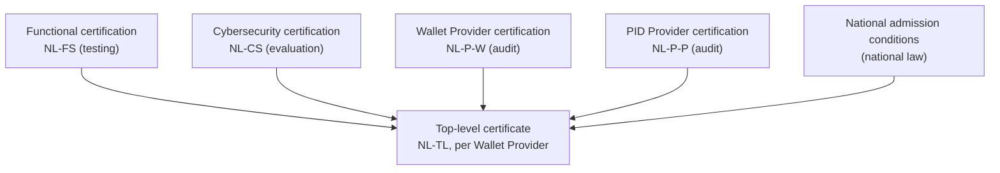

import Cite from "@site/src/components/EdiStelsel/Cite";
import DocLink from "@site/src/components/EdiStelsel/DocLink";

A Wallet Provider ends up with a [top-level certificate](#top-level) that depends on the certificates of three subordinate schemes. This page describes how each of those certifications works and how the top-level certificate is built on them. What happens after certification is on [the life of a certificate](/edi-stelsel-certification/system/certificate-lifecycle).

*What the top-level certificate depends on, following NL-SYS-01 §1 <Cite doc="NL-SYS-01" page={7}>§1</Cite> and the evidence categories of NL-TL Annex A <Cite doc="NL-TL" page={29}>Annex A</Cite>.*

## Functional certification (NL-FS) {#functional}

<DocLink id="NL-FS" /> certifies "the functional behaviour of the wallet solution or the PID issuance service". It checks that the wallet solution or service correctly implements the protocols, interfaces, data formats and other functional requirements of the implementing acts and the technical specifications they reference <Cite doc="NL-FS" page={6}>§1.1</Cite>. Wallet providers are certified for their wallet solution and PID providers for their PID issuance services <Cite doc="NL-FS" page={6}>§1.1</Cite>. The requirements are listed in <DocLink id="NL-FS-W" /> for wallet solutions and <DocLink id="NL-FS-P" /> for PID issuance services. If a wallet solution includes wallet units for several OS versions (for example iOS and Android), the certification body treats them as separate objects of certification <Cite doc="NL-FS" page={21}>§9.1.1</Cite>.

The process <Cite doc="NL-FS" page={13}>§6.1</Cite>:

1. **Preparation, before any certification:** the certification body derives test objectives and test cases from the functional requirements. It can do so directly or by reference to an existing test standard, such as the European Commission's Functional Conformance Assessment Framework (FCAF). It also develops or references the ICS templates <Cite doc="NL-FS" page={13}>§6.1</Cite>. The test cases are preferably implemented in an automated conformance test tool <Cite doc="NL-FS" page={14}>§6.1</Cite>. The certification body may decide to reference the FCAF, but this is not mandatory <Cite doc="NL-FS" page={22}>§9.2</Cite>.
2. **The developer completes the Implementation Conformance Statement (ICS)** of NL-FS-W or NL-FS-P, plus the ICS of each supported technical specification. The ICS declares which features are implemented, which determines the tests that apply <Cite doc="NL-FS" page={14}>§6.1</Cite>.
3. **Testing:** the applicable test cases are executed <Cite doc="NL-FS" page={14}>§6.1</Cite>. Execution should be performed by the certification body, directly or through a qualified outsourced partner, but may also be done by the developer using a tool qualified by the certification body <Cite doc="NL-FS" page={21}>§9.1.3</Cite>. Testing takes place in a controlled test framework, so that it is impartial and reproducible <Cite doc="NL-FS" page={21}>§9.1.1</Cite>.
4. **Evaluation and decision:** the certification body evaluates the evidence. The decision is Pass or Fail, taken according to the common process of NL-SYS-01 <Cite doc="NL-FS" page={14}>§6.1–6.2</Cite>.
5. **Certificate:** the expiry date is at most 5 years after the issuance date <Cite doc="NL-FS" page={20}>§8.4</Cite>.

NL-FS and NL-CS are assessed and certified independently of each other; neither replaces the other <Cite doc="NL-FS" page={12}>§5.3</Cite>. An NL-FS certificate is internal assurance information within the certification hierarchy. It does not by itself give the right to use the EU Digital Identity Wallet Trust Mark <Cite doc="NL-FS" page={12}>§5.5</Cite>.

## Cybersecurity certification (NL-CS) {#cybersecurity}

The cybersecurity certification has at least two parts <Cite doc="NL-SYS-01" page={6}>§1</Cite>:

- The **WSCA and WSCD** are certified under the EUCC scheme. <DocLink id="NL-CS-WSCA" /> is the Common Criteria protection profile for a WSCA in a remote HSM architecture. It comes with conditions for the platform underneath (<DocLink id="NL-CS-WSCA-COND" />).
- The **Wallet Instance** is evaluated under a national FITCEM scheme (EN 17640:2022), described in <DocLink id="NL-CS-P1">NL-CS Part 1</DocLink> (scheme specification) and <DocLink id="NL-CS-P2">Part 2</DocLink> (procedures). The requirements are in the protection profile <DocLink id="NL-CS-WI" /> and the conditions on the mobile platform (<DocLink id="NL-CS-WI-COND" />). <DocLink id="NL-CS-P3">Part 3</DocLink> instructs the evaluation laboratories, and <DocLink id="NL-CS-P4">Part 4</DocLink> is the audit instruction for the developer's operational processes.

The assurance level is high, and this is mandatory: substantial is not sufficient <Cite doc="NL-CS-P1" page={5}>§1.1</Cite>. Under the current draft protection profile, the Wallet Instance is a standalone target of evaluation. The WSCA backend and the WSCD are part of its operational environment <Cite doc="NL-CS-P1" page={8}>§2.1</Cite>. Only the remote WSCA-WSCD architecture is admitted. Embedded secure element and eSIM variants require a protection profile before certification. A variant without a dedicated secure element is not admitted at assurance level high <Cite doc="NL-CS-P1" page={8}>§2.3</Cite>.

The phases of the Wallet Instance certification <Cite doc="NL-CS-P1" page={17}>§6.1</Cite>:

1. **Application:** the product developer selects an authorised certification body (CB). It submits the FIT Security Target, a risk assessment, a proposed evaluation plan, the functional certificate and the prerequisite documentation. Only providers referred to in Article 5a(2) of eIDAS are eligible to be issued a certificate <Cite doc="NL-CS-P2" page={9}>§2.1</Cite>.
2. **Evaluation planning:** the CB reviews the application. It prepares the evaluation plan with the developer and the evaluation laboratory, and approves it in writing before the evaluation starts <Cite doc="NL-CS-P2" page={11}>§3.1</Cite>.
3. **FITCEM evaluation:** the evaluation laboratory performs the evaluation tasks of EN 17640:2022 within a fixed time budget, under the responsibility of the CB <Cite doc="NL-CS-P1" page={17}>§6.1</Cite>. The effort is fixed rather than scaled to functionality <Cite doc="NL-CS-P1" page={15}>§5.2–5.3</Cite>.
4. **Process audit:** the CB performs an initial audit of the developer's operational processes, according to the audit instruction (<DocLink id="NL-CS-P4">NL-CS Part 4</DocLink>) <Cite doc="NL-CS-P1" page={17}>§6.1</Cite>.
5. **Evaluation review meeting** (optional) <Cite doc="NL-CS-P1" page={17}>§6.1</Cite>.
6. **Certification decision:** the CB's certifying function reviews the evaluation technical report and the audit reports. It takes the decision and issues the certificate of conformity and the certification report <Cite doc="NL-CS-P1" page={17}>§6.1</Cite>.

The required test set is built on OWASP MAS: the MASVS, MASWE and MASTG, the testing profiles L2 + R + P, and the [OWASP MAS EUDI Wallet profile](/edi-stelsel-certification/requirements/owasp-mas-eudiw) on top. NL-CS Part 1 describes that profile as a draft that is not yet normative <Cite doc="NL-CS-P1" page={14}>§4.4</Cite>.

A valid functional certificate for the same product, with the same version, is a precondition. No certificate of conformity is issued under the scheme without one <Cite doc="NL-CS-P1" page={17}>§6.2</Cite>. The maximum certificate validity is five years <Cite doc="NL-CS-P1" page={18}>§6.3</Cite>.

## Wallet Provider and PID Provider certification (NL-P) {#provider}

<DocLink id="NL-P-W" /> (Wallet Provider) and <DocLink id="NL-P-P" /> (PID Provider) certify the providers and the services they operate. The main evaluation activity is audit, and the certification bodies are accredited to ISO/IEC 17065 augmented by ETSI EN 319 403-1 V2.3.1 <Cite doc="NL-SYS-01" page={16}>§4.3</Cite>. The requirements are in <DocLink id="NL-P-01" /> (both providers), <DocLink id="NL-P-02" /> (both), <DocLink id="NL-P-03" /> (both), <DocLink id="NL-P-04W" /> (Wallet Provider) and <DocLink id="NL-P-04P-1">NL-P-04P</DocLink> (PID Provider) <Cite doc="NL-SYS-01" page={15}>§4.2</Cite>. According to NL-SYS-01, the validity of the Wallet Provider and PID Provider certificates is four years <Cite doc="NL-SYS-01" page={23}>§5.10</Cite>.

The NL-P-W certification process has three phases: preparation and application, evaluation, and certification <Cite doc="NL-P-W" page={17}>§8.1</Cite>. For a Wallet Provider:

1. **Application:** the applicant provides <Cite doc="NL-P-W" page={17}>§8.2</Cite>:
   - a description of its environment and systems;
   - documentation that demonstrates compliance with the NL-P-W requirement documents;
   - valid NL-FS and NL-CS certificates for the wallet solution versions in scope, or declarations that those certification processes are in place;
   - any external assurance evidence it wants the CAB to rely on, such as ISO/IEC 27001 certificates or audit reports;
   - the completed application form.

   The application can be combined with applications under other schemes of the system <Cite doc="NL-P-W" page={17}>§8.2</Cite>.
2. **Kick-off:** a kick-off meeting is held no later than 10 working days after a complete application has been received. The applicant, representatives of the Scheme Owner and the CAB attend, and the CAB agrees the evaluation plan with the applicant <Cite doc="NL-P-W" page={17}>§8.3.1</Cite>.
3. **Evaluation:** the CAB evaluates against the requirement documents and records the results in an Evaluation Report. The report gives an overall assessment of conformity with each requirement and a recommendation for the decision <Cite doc="NL-P-W" page={18}>§8.3.2</Cite>. Initial and re-assessment audits should normally comprise a Stage 1 and a Stage 2 <Cite doc="NL-P-W" page={32}>Annex B</Cite>. Each applicable requirement's result is Conforming, Major nonconformity, Minor nonconformity or Not concluded <Cite doc="NL-P-W" page={33}>Annex B</Cite>.
4. **Decision:** after reviewing the evaluation results, the CAB completes the decision and informs the applicant within 5 working days. After a positive decision, the certificate is issued no later than 14 working days later. After a negative decision, the applicant has 14 working days to lodge a written complaint. The CAB issues a final decision within 14 working days of receiving it <Cite doc="NL-P-W" page={18}>§8.4</Cite>.
5. **Certificate:** before issuing the certificate, the CAB verifies that the applicant holds valid NL-FS and NL-CS certificates for the wallet solution versions concerned. It does not issue the certificate if any of them is absent, expired, suspended or withdrawn <Cite doc="NL-P-W" page={19}>§8.7</Cite>. The certificate is valid for four years from the date of issuance <Cite doc="NL-P-W" page={18}>§8.6</Cite>. The CAB notifies the Scheme Owner within five working days of issuance <Cite doc="NL-P-W" page={19}>§8.7</Cite>.

The indicative CAB effort for an initial certification is 30 working days for evaluation and 15 working days for certification. These are maximum and planned values that may change upon agreement with the Scheme Owner <Cite doc="NL-P-W" page={18}>§8.5</Cite>.

The certification process of the PID Provider scheme is summarised, with its own page references, on the <DocLink id="NL-P-P">NL-P-P page</DocLink>.

## Top-level certification (NL-TL) {#top-level}

<DocLink id="NL-TL" /> is the scheme for Wallet Providers that seek a top-level certificate and admission to the national eID scheme <Cite doc="NL-TL" page={7}>§2</Cite>. The object of certification covers both <Cite doc="NL-TL" page={7}>§2</Cite>:

- the **Wallet Provider**: it satisfies the requirements of the scheme, holds the required underlying certificates and meets the national admission conditions in national law;
- the **government-assigned PID Provider** that the Wallet Provider is linked to: it also satisfies the requirements and holds the required certificates.

Only a certification body that is accredited and also authorised under Dutch law is eligible as CAB <Cite doc="NL-TL" page={11}>§6.1</Cite>. The same CAB may perform the top-level certification and one or more subordinate certifications, provided impartiality, separation of review and decision, and the competence requirements are maintained <Cite doc="NL-TL" page={21}>§8.1</Cite>.

The process comprises application review, evaluation, review, certification decision, issuance, surveillance, change handling, suspension or withdrawal where applicable, and recertification <Cite doc="NL-TL" page={21}>§8.1</Cite>.

### 1. Application {#tl-application}

The applicant identifies the precise object and scope of the top-level certification. The application includes at least <Cite doc="NL-TL" page={21}>§8.2</Cite>:

- the legal identity and contact details of the Wallet Provider;
- the Wallet Solution and each version, configuration and deployment model in scope;
- the government-assigned PID Provider, and the relationship through which PID issuance is provided to the Wallet Solution;
- a complete inventory of mandatory subordinate certificates and declarations of conformity, with identifiers, issuing CABs, objects, scopes, versions, validity periods and status;
- evidence that the Wallet Provider satisfies the national admission conditions;
- the organisational, technical and contractual dependencies and interfaces between the Wallet Provider, the Wallet Solution, the PID Provider and the national eID scheme;
- known changes, limitations, exclusions, open findings, suspensions, incidents or other circumstances that may affect the certification;
- other assurance evidence for which the applicant requests reliance;
- the application and contractual information the CAB requires.

The CAB reviews the application for completeness and does not start the evaluation until the object, the certificate set, the admission conditions and the relevant interfaces are sufficiently defined <Cite doc="NL-TL" page={22}>§8.2</Cite>.

### 2. Evaluation plan {#tl-plan}

The CAB prepares an evaluation plan, proportionate to the composite nature and the risk of the object. The plan distinguishes:

- the aspects accepted on the basis of subordinate certificates;
- the certificate checks the CAB itself performs;
- the admission conditions it verifies directly;
- the dependencies and interfaces it evaluates;
- the gaps that need supplementary evaluation.

This is set out in <Cite doc="NL-TL" page={22}>§8.3</Cite>. Annex C lists the minimum contents of the plan <Cite doc="NL-TL" page={32}>Annex C</Cite>.

### 3. Evaluation {#tl-evaluation}

- **Subordinate certificates:** for every mandatory subordinate certificate or result, the CAB verifies authenticity, the competence and accreditation of the issuing body, the object, scope, versions, validity, status, conditions, limitations and continuing applicability <Cite doc="NL-TL" page={22}>§8.4.1</Cite>.
- **Collective coverage and interfaces:** the CAB evaluates whether the subordinate results together cover the complete top-level object, including the link between the Wallet Provider and the PID Provider <Cite doc="NL-TL" page={22}>§8.4.2</Cite>.
- **National admission conditions:** the CAB verifies each applicable admission condition. Where national law reserves the admission decision to a competent authority, the CAB verifies that authority's determination and does not substitute its own decision <Cite doc="NL-TL" page={22}>§8.4.3</Cite>.
- **Supplementary evaluation:** where the evidence is incomplete, the CAB performs or requires supplementary evaluation, limited to the uncovered matter. Supplementary evaluation cannot replace a mandatory subordinate certificate <Cite doc="NL-TL" page={23}>§8.4.4</Cite>.

For each aspect, reliance is recorded as Full, Partial or None <Cite doc="NL-TL" page={30}>Annex B.3</Cite>. In the evaluation results matrix, each requirement's result is Conforming, Major nonconformity, Minor nonconformity or Not concluded <Cite doc="NL-TL" page={34}>Annex E</Cite>.

### 4. Report, review and decision {#tl-decision}

A positive recommendation cannot be made while a mandatory certificate is absent, expired, suspended, withdrawn or insufficient in scope. The same applies while a material top-level gap or an unresolved major nonconformity remains <Cite doc="NL-TL" page={23}>§8.5</Cite>. A person or function not involved in the evaluation reviews the evaluation information. The decision is made by the CAB and is not delegated to an external body <Cite doc="NL-TL" page={23}>§8.6</Cite>.

A positive decision requires all of the following <Cite doc="NL-TL" page={23}>§8.6</Cite>:

- all mandatory subordinate certificates are authentic, valid, in force, applicable and sufficient in scope;
- all applicable national admission conditions are fulfilled;
- collective coverage of the Wallet Provider, Wallet Solution and linked PID Provider is demonstrated;
- material dependencies and interfaces have been evaluated;
- any supplementary evaluation has been completed;
- no unresolved major nonconformity or evidence gap prevents a conformity conclusion;
- the proposed certificate scope accurately reflects the demonstrated conformity.

After a negative decision, the CAB informs the applicant of the reasons and of the complaint and appeal arrangements <Cite doc="NL-TL" page={23}>§8.6</Cite>.

### 5. The top-level certificate {#tl-certificate}

The certificate identifies, among other things:

- the certificate holder;
- the Wallet Solution and its versions;
- the linked government-assigned PID Provider;
- the scope;
- NL-TL and its version;
- the subordinate certificates it depends on;
- its decision, issue and expiry dates, and the issuing CAB.

It also states that its validity depends on the continuing validity of those subordinate certificates and on the admission conditions <Cite doc="NL-TL" page={24}>§8.7</Cite>. Annex F lists the minimum contents <Cite doc="NL-TL" page={35}>Annex F</Cite>. The CAB provides the certificate information to the Scheme Owner for the register <Cite doc="NL-TL" page={24}>§8.7</Cite>.

Only the NL EUDI Wallet Mark, as defined in <DocLink id="NL-SYS-03" />, is used as mark of conformity under NL-TL <Cite doc="NL-TL" page={12}>§6.6</Cite>. According to NL-SYS-01, the Trust Mark as defined in Implementing Regulation (EU) 2024/2981 will be used only for the top-level certificate <Cite doc="NL-SYS-01" page={30}>§7.1.1</Cite>.

The CAB concludes an enforceable certification agreement with the applicant <Cite doc="NL-TL" page={28}>§10.2</Cite>. NL-SYS-01 and applicable law prevail where NL-TL conflicts with them <Cite doc="NL-TL" page={28}>§10.5</Cite>.
